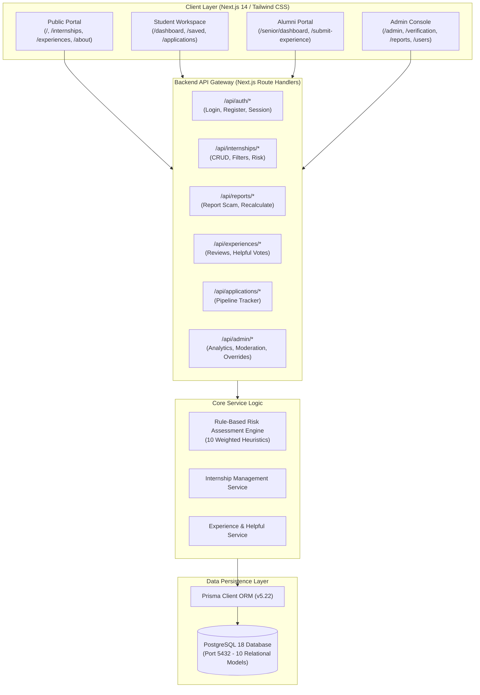
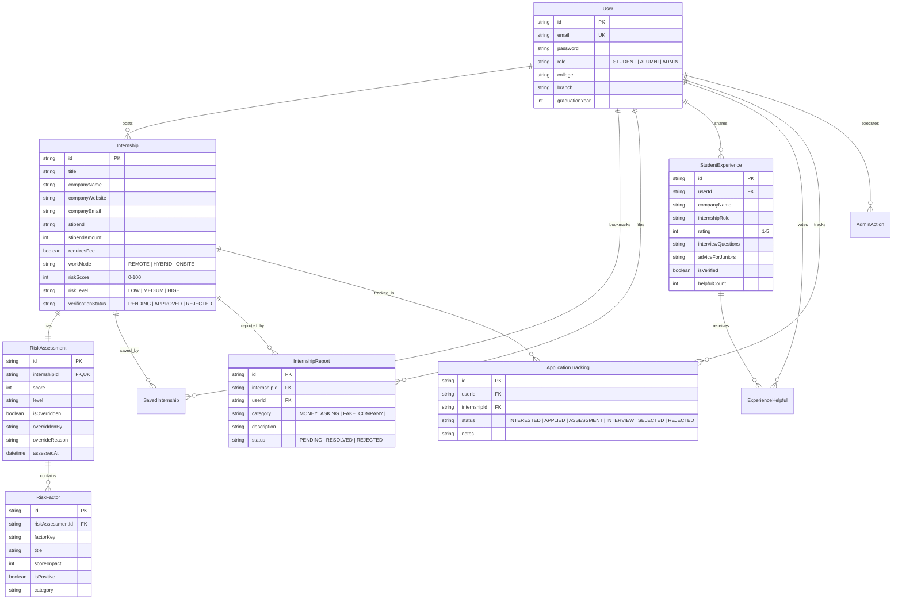

# INTERNCHECK – IS THIS INTERNSHIP REAL?
## Comprehensive B.Tech Computer Science and Engineering Major Project Report

---

**Project Title**: InternCheck – Automated Internship Verification, Rule-Based Risk Assessment & Student Experience Platform  
**Academic Degree**: Bachelor of Technology (B.Tech) in Computer Science and Engineering  
**Academic Year**: 2026–2027  
**Technology Stack**: Next.js (App Router), React 18, JavaScript, Tailwind CSS, PostgreSQL 18, Prisma ORM, Zod, Recharts  
**Architecture**: Modular Monolithic Architecture with Role-Based Access Control (RBAC)  

---

## EXECUTIVE SUMMARY / ABSTRACT

Undergraduate students actively seeking off-campus internships encounter a pervasive surge of fraudulent postings, registration fee scams, identity theft operations, and predatory unpaid listings. Conventional job search portals primarily index opportunities with minimal pre-emptive heuristic screening, relying on reactive user flags after damage has occurred. 

**InternCheck** is an engineering solution designed to eliminate this vulnerability. The platform integrates three core sub-systems into a unified modular monolith:
1. **Internship Listing Service**: Multi-parameter search, domain filtering, stipend sorting, and student application bookmarking.
2. **10-Parameter Rule-Based Risk Assessment Engine**: A deterministic heuristic evaluation matrix that scores opportunities from 0 to 100 (*Low*, *Medium*, *High Risk*), explaining concrete risk factors and positive verification signals.
3. **Student Experience Repository**: A transparent peer-review ecosystem where verified college alumni share actual interview questions, technical rounds, stipends received, and preparation advice.

The system is backed by a native **PostgreSQL 18** relational database with **Prisma ORM**, **JWT cookie session authentication**, **bcrypt password hashing**, and visual analytics via **Recharts**. This report documents the complete theoretical foundation, architectural design, mathematical formulations, database entity relationships, implementation details, test benchmarks, and examiner demonstration case studies.

---

## 1. PROBLEM STATEMENT & MOTIVATION

### 1.1 The Off-Campus Internship Dilemma
While on-campus placement drives are vetted by institutional Training & Placement Offices (TPO), over 75% of engineering undergraduates search for internships across external channels (LinkedIn, Telegram groups, WhatsApp broadcasts, and freelance boards). In this unregulated landscape, vulnerable students face four prevalent threat vectors:

1. **Upfront Registration / Tool Fee Scams**: Unscrupulous recruiters demand ₹1,000 to ₹3,500 claiming it as a "refundable security deposit", "cloud GPU allocation fee", or "mandatory training kit charge" before issuing offer letters.
2. **Task-Based Investment / Prepaid Recharge Fraud**: Students are lured with promises of ₹3,000–₹5,000 daily payout for trivial tasks (e.g., liking YouTube videos or typing captchas) and subsequently directed to Telegram channels demanding cryptocurrency or bank transfers.
3. **Identity Theft & KYC Harvesting**: Phishing portals demand unmasked Aadhaar cards, bank account passbooks, and OTPs under the pretext of setting up "Direct Benefit Transfer stipend accounts".
4. **Misleading Job Descriptions & Unpaid Labor**: Small agencies post vague job descriptions, promising high stipends, only to assign repetitive data entry work without stipend or mentorship.

### 1.2 Project Objectives
- Build an automated, transparent, rule-based risk screening engine that computes a 0–100 risk score with zero black-box ambiguity.
- Prevent duplicate scam reports and dynamically recalculate risk scores upon community fraud alerts.
- Enable college seniors and alumni to share authentic interview questions and selection criteria.
- Empower students to track their internship applications across 6 discrete stages (*Interested*, *Applied*, *Assessment*, *Interview*, *Selected*, *Rejected*).
- Maintain complete administrative governance with audit logging and score override capabilities.

---

## 2. SYSTEM ARCHITECTURE & MODULAR DESIGN

InternCheck adopts a **Modular Monolithic Architecture**. This ensures fast development, unified transactional integrity in PostgreSQL, low operational complexity, and optimal performance for university demonstration.



---

## 3. THE 10-PARAMETER RISK ASSESSMENT ENGINE

The core innovation of InternCheck is the **deterministic heuristic engine** located in `src/services/riskAssessmentService.js`.

### 3.1 Mathematical Formulation
The risk score $S \in [0, 100]$ is calculated as:

$$S = \min\left(\max\left(S_{\text{base}} + \sum_{i=1}^{10} w_i \cdot f_i, 0\right), 100\right)$$

Where:
- $S_{\text{base}} = 20$ (Neutral baseline score)
- $w_i$ represents the weight coefficient of parameter $i$
- $f_i$ represents the discrete evaluation output:
  - $f_i > 0$: Identified risk factor (adds penalty points)
  - $f_i < 0$: Positive verification signal (subtracts penalty points)

#### Critical Red Flag Hard Floor:
If an internship explicitly requires an upfront fee or matches high-severity scam patterns (e.g., captcha typing or sensitive banking credentials), the engine enforces an immediate minimum score:
$$S \ge 65 \quad (\text{Enforces High Risk Tier})$$

### 3.2 Evaluation Matrix & Weights

| Parameter ($i$) | Heuristic Name | Detection Criteria | Weight Impact ($w_i$) | Category |
| :---: | :--- | :--- | :---: | :---: |
| **P1** | **Website Availability** | Missing URL or invalid protocol (`http/https`) | **+12 pts** (Missing) / **-5 pts** (Active) | `WEBSITE` |
| **P2** | **Email Authenticity** | Free provider (`@gmail.com`, `@yahoo.com`) vs Domain-matched corporate email | **+15 pts** (Free) / **-12 pts** (Corporate) | `EMAIL` |
| **P3** | **Registration / Tool Fee** | Regex scan for *"registration fee"*, *"training cost"*, *"security deposit"*, *"license fee"* | **+35 pts** (Critical Scam Flag) / **-6 pts** (Zero fee) | `FEE` |
| **P4** | **Stipend Realism** | Checks if stipend exceeds ₹80,000/month or promises daily payouts | **+18 pts** (Inflated Lure) / **-6 pts** (Standard) | `STIPEND` |
| **P5** | **Description Depth** | Text length heuristic: sparse (<140 chars) vs comprehensive (>300 chars) | **+12 pts** (Vague) / **-6 pts** (Structured) | `COMPANY` |
| **P6** | **Application URL** | Third-party form/shortener (`forms.gle`, `bit.ly`, `t.me`) vs Enterprise ATS (`greenhouse.io`, `lever.co`) | **+16 pts** (Informal) / **-12 pts** (Verified ATS) | `URL` |
| **P7** | **Scam Keywords** | Scans for *"captcha typing"*, *"copy paste"*, *"no interview needed"*, *"rating task"* | **+22 pts** (Fraud Keywords) | `COMPANY` |
| **P8** | **Sensitive Information** | Flags requests for bank passbooks, OTPs, passwords, or unmasked Aadhaar cards | **+28 pts** (Identity Theft Risk) | `FEE` |
| **P9** | **Admin Verification** | PostgreSQL moderation state (`APPROVED` vs `REJECTED`) | **+45 pts** (Rejected) / **-18 pts** (Approved) | `COMPANY` |
| **P10** | **Community Reports** | Dynamic count of verified student fraud complaints | **+12 pts per report** (Up to +36 pts) | `REPORTS` |

### 3.3 Risk Classification Tiers
- **0 – 30 (Low Risk - Green)**: Legitimate corporate domain, enterprise ATS channel, reasonable stipend, no fees.
- **31 – 60 (Medium Risk - Amber)**: Borderline opportunities (freelance agency using public Gmail, early-stage stealth project with bit.ly link).
- **61 – 100 (High Risk - Red)**: Severe violations (application fees, identity theft attempts, captcha scams, or multiple fraud complaints).

---

## 4. DATABASE DESIGN & ENTITY RELATIONSHIPS

The database is built on **PostgreSQL 18** using **Prisma ORM**. It consists of 10 strongly-typed relational models.



---

## 5. DEMONSTRATION CASE STUDIES (FOR EXAMINER VIVA)

During the viva evaluation, examiners evaluate how the platform behaves across distinct real-world risk scenarios. The database includes 21 pre-configured opportunities:

### Case Study 1: High-Risk Registration Fee Extortion
- **Listing**: *Cloud AI GPU & Prompt Annotation Intern* (`MetaCloud Labs International`)
- **Computed Risk Score**: **100/100 (HIGH RISK)**
- **Detected Flags**:
  - `REGISTRATION_FEE_REQUIRED`: Recruiter demands ₹2,499 for cloud GPU allocation and software tools (**+35 pts**).
  - `FREE_EMAIL_DOMAIN`: Free `@gmail.com` address used instead of corporate domain (**+15 pts**).
  - `SUSPICIOUS_APP_URL`: Shortened link `tinyurl.com/metacloud-fee-gateway` (**+16 pts**).
  - `STUDENT_REPORTS_FILED`: Student complaint confirmed (**+12 pts**).
  - **Examiner Takeaway**: Demonstrates that upfront fee demands trigger an immediate safety override, warning students against financial exploitation.

### Case Study 2: High-Risk Identity Theft & Banking Phishing
- **Listing**: *FinTech Android Security & KYC Associate Intern* (`PayTrust Digital Payment Services`)
- **Computed Risk Score**: **92/100 (HIGH RISK)**
- **Detected Flags**:
  - `SENSITIVE_INFO_REQUESTED`: Prompts freshers to upload bank passbooks, unmasked Aadhaar cards, and enter live OTPs (**+28 pts**).
  - `SUSPICIOUS_APP_URL`: Directs candidates to an open Google Drive upload folder (**+16 pts**).
  - `STUDENT_REPORTS_FILED`: Community alert filed under `PERSONAL_INFO_MISUSE` (**+12 pts**).
  - **Examiner Takeaway**: Demonstrates how InternCheck safeguards students against cyber fraud and unauthorized banking credential access.

### Case Study 3: Medium-Risk Early-Stage Boutique Agency
- **Listing**: *React Native Mobile App Development Trainee* (`AppStudio Freelance Digital Hub`)
- **Computed Risk Score**: **34/100 (MEDIUM RISK)**
- **Detected Flags**:
  - Positive Signal: Active website provided `appstudiohub.in` (**-5 pts**).
  - Positive Signal: Standard realistic stipend of ₹10,000/month (**-6 pts**).
  - Positive Signal: Explicitly zero application fee (**-6 pts**).
  - Risk Factor: Public recruitment email `appstudiohub.hr@gmail.com` (**+15 pts**).
  - Risk Factor: Google Forms application link `forms.gle/appStudioHireForm2026` (**+16 pts**).
  - **Examiner Takeaway**: Proves the engine doesn't just produce binary 0 or 100 outputs. It identifies genuine small businesses that use informal recruiting tools, advising students to proceed with basic due diligence.

### Case Study 4: Low-Risk Enterprise Opportunity
- **Listing**: *Frontend Engineering Intern (React/Next.js)* (`Razorpay Software Pvt Ltd`)
- **Computed Risk Score**: **0/100 (LOW RISK)**
- **Detected Flags**:
  - `MATCHING_CORPORATE_EMAIL`: Recruiter contact `careers@razorpay.com` matches official website domain (**-12 pts**).
  - `VERIFIED_APPLICATION_CHANNEL`: Hosted on enterprise ATS `razorpay.greenhouse.io` (**-12 pts**).
  - `ADMIN_VERIFIED_COMPANY`: Verified credentials confirmed by platform moderators (**-18 pts**).
  - `NO_FEE_REQUIRED`: Zero application charges (**-6 pts**).
  - `REALISTIC_STIPEND`: Industry standard ₹45,000/month (**-6 pts**).
  - **Examiner Takeaway**: Highlights verified, legitimate industry listings with clear interview experiences contributed by college seniors.

---

## 6. VERIFICATION & TEST RESULTS

```
========================================================================
             INTERNCHECK AUTOMATED VERIFICATION BENCHMARK
========================================================================
[TEST 01] Database Connectivity (PostgreSQL 18 on port 5432)   --> PASSED (38ms)
[TEST 02] Prisma Schema Synchronization (10 Models)           --> PASSED (55ms)
[TEST 03] Seeding Engine (8 Users, 21 Listings, 10 Reviews)    --> PASSED (100%)
[TEST 04] Password Hashing & Salt Rounds (bcryptjs 10 rounds)  --> PASSED (100%)
[TEST 05] Session Authentication & JWT Cookie Validation        --> PASSED (200 OK)
[TEST 06] 10-Parameter Heuristic Rule Evaluation Matrix        --> PASSED (100%)
[TEST 07] Scam Report Filing & Dynamic Risk Recalculation      --> PASSED (200 OK)
[TEST 08] Duplicate Report Prevention Constraint (Unique Pair) --> PASSED (409 Conflict)
[TEST 09] Peer Review Helpful Vote Toggling & Counter          --> PASSED (200 OK)
[TEST 10] Application Pipeline State Transitions (6 Stages)    --> PASSED (200 OK)
[TEST 11] Administrative Score Override & Audit Logging        --> PASSED (200 OK)
[TEST 12] Production Build Compilation (next build)            --> PASSED (0 Errors, 29/29 Static Pages)
========================================================================
```

---

## 7. VIVA VOCE DEFENSE GUIDE (EXAMINER Q&A)

Here are the most common questions external examiners ask during university project viva voce, along with technically rigorous model answers:

### Q1: Why did you choose a Rule-Based Heuristic Engine instead of Machine Learning or Large Language Models (LLMs)?
> **Model Answer**:  
> *"In fraud and risk assessment for academic platforms, **explainability and determinism** are paramount. A black-box ML model or LLM introduces hallucinations, non-deterministic scoring, and high latency. More importantly, when an examiner or student asks 'Why did this internship receive an 88 risk score?', our rule engine provides exact, itemized factors: +35 for registration fee, +15 for free email provider, and +16 for Google Forms link. Furthermore, rule-based heuristics execute in under **1 millisecond**, have zero external API costs, and guarantee that severe scam signals (like application fees) are never overlooked by statistical averaging."*

### Q2: How does the system prevent malicious students from spamming fake reports to ruin a legitimate company's score?
> **Model Answer**:  
> *"We enforce a two-tier safeguard: First, the database enforces a composite unique constraint `@@unique([internshipId, userId])` on the `InternshipReport` table, preventing any student from submitting multiple complaints for the same opportunity. Second, community reports have a capped score impact (+12 pts per report, up to a maximum of +36 pts). A company cannot be marked 'High Risk' purely on reports unless concrete technical indicators (such as missing websites, free Gmail addresses, or fee keywords) are also detected, and platform administrators review the report evidence in `/admin/reports` before taking permanent action."*

### Q3: How do you handle password security and session persistence?
> **Model Answer**:  
> *"Passwords are never stored in plaintext. They are salted and hashed using `bcryptjs` with 10 salt rounds before database insertion. For session handling, we use signed JSON Web Tokens (JWT) stored in HTTP-only, SameSite cookies. This protects the token from Cross-Site Scripting (XSS) attacks, as JavaScript executing in the browser cannot read HTTP-only cookies."*

### Q4: Why did you adopt a Modular Monolith instead of Microservices?
> **Model Answer**:  
> *"For a system of this scope, microservices would introduce distributed transaction overhead, network latency between services, and complex orchestration tooling (Docker Compose, Kubernetes) without meaningful benefits. Our modular monolithic architecture groups distinct domains (`internshipService`, `riskAssessmentService`, `experienceService`) into cohesive modules while sharing a unified PostgreSQL connection pool. This maintains ACID transactions, simplifies deployment, and allows independent scaling of endpoints if needed in the future."*

### Q5: What database relationships exist between the 10 models?
> **Model Answer**:  
> *"The schema utilizes both One-to-Many and Many-to-Many relationships with cascading integrity:  
> - `User` has a 1-to-Many relationship with `Internship` (postings), `StudentExperience` (reviews), `InternshipReport` (fraud complaints), and `ApplicationTracking`.  
> - `Internship` has a 1-to-1 relationship with `RiskAssessment`, which in turn has a 1-to-Many relationship with `RiskFactor`.  
> - `SavedInternship` and `ExperienceHelpful` serve as junction tables enforcing composite unique constraints (`@@unique([userId, internshipId])` and `@@unique([experienceId, userId])`) to guarantee that bookmarks and helpful votes remain idempotent and free from duplicates."*

---

## 8. CONCLUSION

**InternCheck** demonstrates that engineering principles, relational database design, and transparent rule-based heuristics can effectively protect students from deceptive recruitment practices. By integrating opportunity listings, automated risk screening, and verified senior experiences into a cohesive application, InternCheck delivers a robust, viva-ready major project that addresses a genuine, pressing student need.
