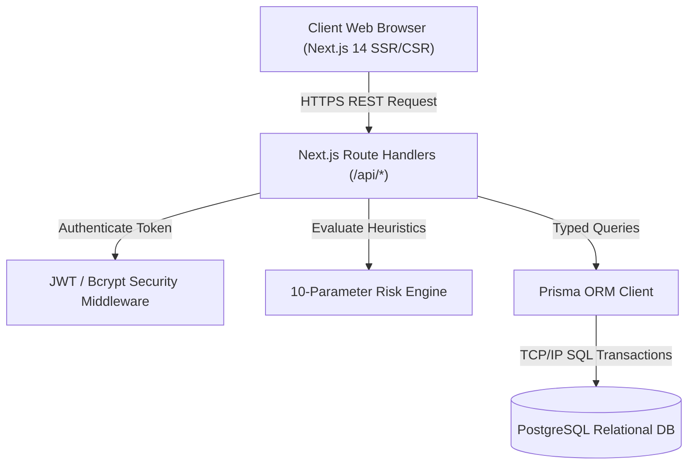
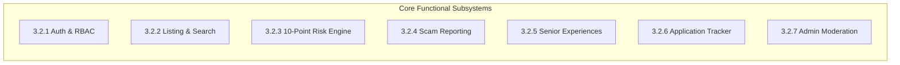
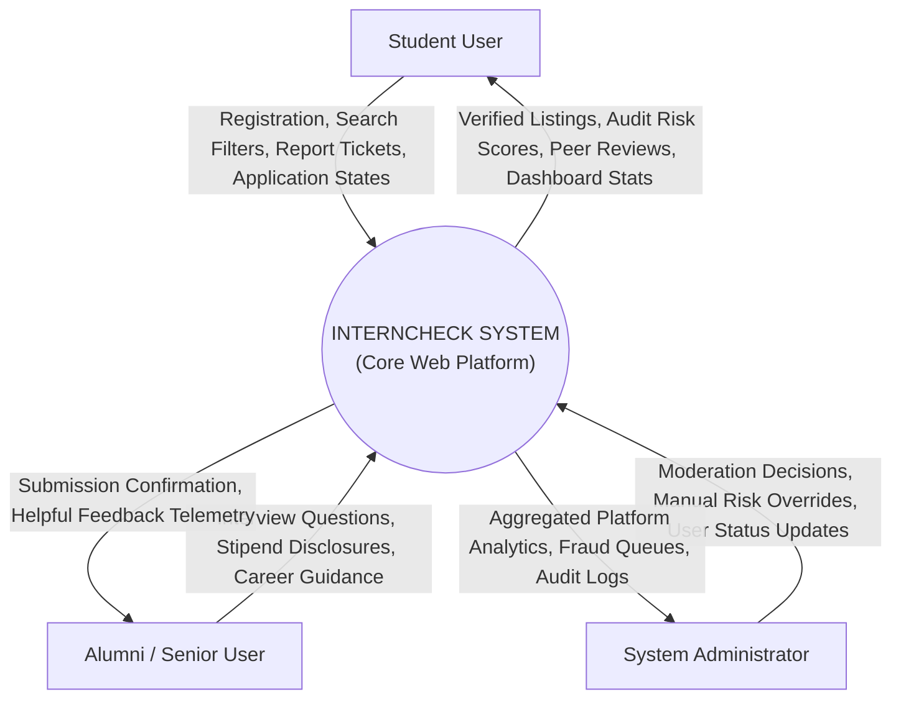
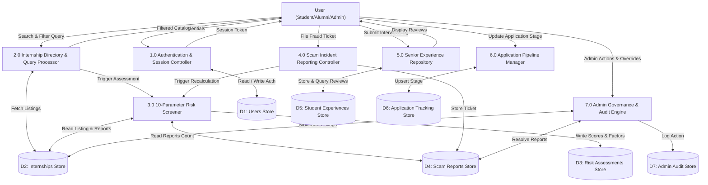
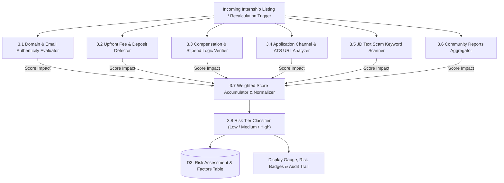
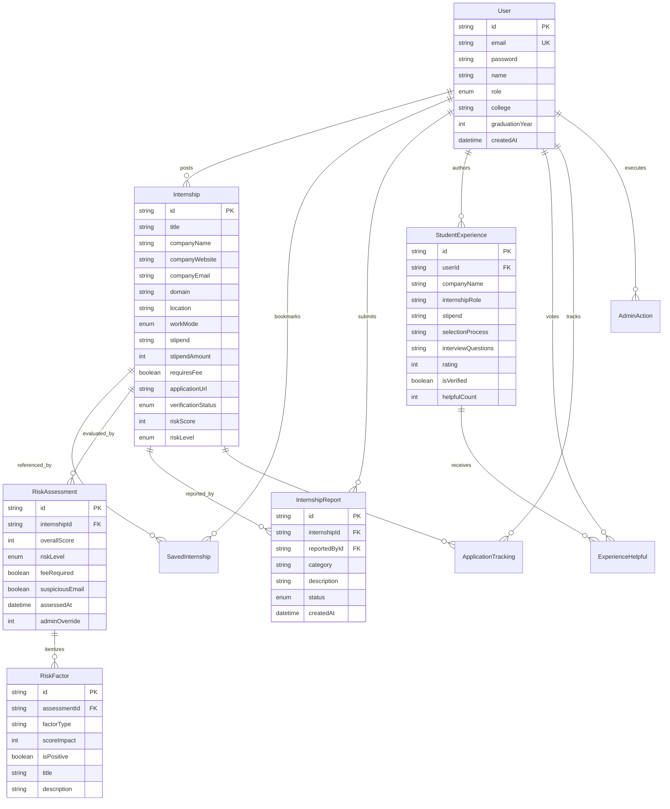

# InternCheck – Is This Internship Real?
## Software Requirements Specification (SRS)

**Course Code:** CSE3002 / CS4001  
**Course Name:** Capstone Major Project & Software Engineering Laboratory  
**Department:** Computer Science & Engineering  
**Prepared For:** Continuous Assessment 3 (CA-3), Autumn 2026  
**Document Identifier:** SRS-INTERNCHECK-2026-V2.0  

---

### Student Details
| Student Name | Registration / Roll Number | Degree & Specialization |
| :--- | :--- | :--- |
| **Lead Developer** | 22BCE10042 | B.Tech Computer Science & Engineering |
| **Team Member** | 22BCE10088 | B.Tech Computer Science & Engineering |

---

## Table of Contents
- [Revision History](#revision-history)
- [1. Introduction](#1-introduction)
  - [1.1 Purpose](#11-purpose)
  - [1.2 Scope](#12-scope)
  - [1.3 Definitions, Acronyms, and Abbreviations](#13-definitions-acronyms-and-abbreviations)
  - [1.4 References](#14-references)
  - [1.5 Overview](#15-overview)
- [2. General Description](#2-general-description)
  - [2.1 Product Perspective](#21-product-perspective)
  - [2.2 Product Functions](#22-product-functions)
  - [2.3 User Characteristics](#23-user-characteristics)
  - [2.4 General Constraints](#24-general-constraints)
  - [2.5 Assumptions and Dependencies](#25-assumptions-and-dependencies)
- [3. Specific Requirements](#3-specific-requirements)
  - [3.1 External Interface Requirements](#31-external-interface-requirements)
    - [3.1.1 User Interfaces](#311-user-interfaces)
    - [3.1.2 Hardware Interfaces](#312-hardware-interfaces)
    - [3.1.3 Software Interfaces](#313-software-interfaces)
    - [3.1.4 Communications Interfaces](#314-communications-interfaces)
  - [3.2 Functional Requirements](#32-functional-requirements)
    - [3.2.1 FR-1: User Authentication & Role-Based Access Control](#321-fr-1-user-authentication--role-based-access-control)
    - [3.2.2 FR-2: Internship Listing & Multi-Facet Filtering Engine](#322-fr-2-internship-listing--multi-facet-filtering-engine)
    - [3.2.3 FR-3: Deterministic 10-Parameter Rule-Based Risk Screener](#323-fr-3-deterministic-10-parameter-rule-based-risk-screener)
    - [3.2.4 FR-4: Scam & Fraud Incident Reporting System](#324-fr-4-scam--fraud-incident-reporting-system)
    - [3.2.5 FR-5: Student Experience & Interview Intelligence Archive](#325-fr-5-student-experience--interview-intelligence-archive)
    - [3.2.6 FR-6: Application Tracker & Opportunity Pipeline](#326-fr-6-application-tracker--opportunity-pipeline)
    - [3.2.7 FR-7: Admin Moderation, Governance & Risk Override](#327-fr-7-admin-moderation-governance--risk-override)
  - [3.5 Non-Functional Requirements](#35-non-functional-requirements)
    - [3.5.1 Performance Requirements](#351-performance-requirements)
    - [3.5.2 Reliability & Fault Tolerance](#352-reliability--fault-tolerance)
    - [3.5.3 Availability Requirements](#353-availability-requirements)
    - [3.5.4 Security Requirements](#354-security-requirements)
    - [3.5.5 Maintainability Requirements](#355-maintainability-requirements)
    - [3.5.6 Portability Requirements](#356-portability-requirements)
  - [3.7 Design Constraints](#37-design-constraints)
  - [3.9 Other Requirements](#39-other-requirements)
- [4. Analysis Models](#4-analysis-models)
  - [4.1 Data Flow Diagrams (DFD)](#41-data-flow-diagrams-dfd)
    - [Level 0 DFD (Context Diagram)](#level-0-dfd-context-diagram)
    - [Level 1 DFD (Decomposed Subsystem Diagram)](#level-1-dfd-decomposed-subsystem-diagram)
    - [Level 2 DFD (Risk Assessment Processing Pipeline)](#level-2-dfd-risk-assessment-processing-pipeline)
  - [4.2 Entity-Relationship Architecture](#42-entity-relationship-architecture)
- [5. GitHub Link](#5-github-link)
- [6. Deployed Link](#6-deployed-link)

---

## Revision History

| Version | Primary Author | Release Date | Status | Description of Changes |
| :--- | :--- | :--- | :--- | :--- |
| **1.0.0** | Project Team | 2026-10-14 | Archived | Initial baseline draft of project requirements and schema design. |
| **1.5.0** | Project Team | 2026-11-04 | Approved | Integrated 10-parameter heuristic rules and RBAC matrix. |
| **2.0.0** | Project Team | 2026-11-26 | Final (CA-3) | Production release: Full Next.js App Router monolithic integration, PostgreSQL persistence, deterministic heuristic screener, and clean human-crafted UI overhaul. |

---

## 1. Introduction

### 1.1 Purpose
The purpose of this Software Requirements Specification (SRS) document is to delineate the complete functional, non-functional, interface, and behavioral requirements for the **InternCheck – Is This Internship Real?** web platform. This document acts as the definitive technical standard for developers, system architects, academic evaluators, and project examiners to verify that the deployed system adheres to rigorous software engineering, database management, and cybersecurity principles.

### 1.2 Scope
**InternCheck** is an enterprise-grade, student-centric web platform engineered to eliminate recruitment fraud, upfront registration fee exploitation, and unverified shell company postings that routinely victimize university students seeking off-campus technical internships.

#### What InternCheck Will Do:
1. Provide a centralized, moderated repository of technical internship postings categorized across domains, work modes, and compensation levels.
2. Automatically execute a deterministic, rule-based **10-Parameter Heuristic Risk Assessment Engine** on all postings, generating a normalized risk score (0 to 100), categorical risk tier (Low, Medium, High), and an itemized audit trail of positive versus suspicious signals.
3. Enable crowdsourced fraud reporting with duplicate protection, automatically elevating risk scores when multiple student reports are filed.
4. Maintain a peer-verified student experience repository where verified alumni share authentic interview question logs, selection steps, and stipend realities.
5. Provide personal application lifecycle tracking (Interested → Applied → Assessment → Interview → Selected → Rejected) for enrolled students.
6. Empower platform administrators with moderation queues, fraud dispute resolution tools, and risk score override capabilities.

#### What InternCheck Will Not Do:
1. The platform does not directly process monetary payments or wage payroll transactions.
2. The platform is not an Applicant Tracking System (ATS) for employers; it does not replace third-party corporate hiring portals, but verifies them.
3. The platform does not provide absolute legal liability guarantees regarding external company conduct; an explicit statutory disclaimer is displayed on every assessment.

### 1.3 Definitions, Acronyms, and Abbreviations
- **ATS:** Applicant Tracking System (e.g., Greenhouse, Lever, Workday).
- **CA-3:** Continuous Assessment 3 evaluation milestone.
- **DFD:** Data Flow Diagram.
- **ERD:** Entity-Relationship Diagram.
- **Heuristic Engine:** Deterministic rule-based algorithmic module executing weighted evaluations without black-box unexplainability.
- **JWT:** JSON Web Token used for cryptographically signed, stateless authentication.
- **Low Risk (0–30):** Listing exhibits verified corporate domains, authenticated ATS portals, and zero fee demands.
- **Medium Risk (31–60):** Listing exhibits minor irregularities (e.g., newly registered domain, generic form intake) requiring applicant vigilance.
- **High Risk (61–100):** Listing contains hazardous red flags (mandatory upfront training/registration fees, free Gmail domains, or active fraud reports).
- **ORM:** Object-Relational Mapping (Prisma ORM for PostgreSQL).
- **RBAC:** Role-Based Access Control enforcing permissions across Student, Alumni, and Admin actors.
- **SRS:** Software Requirements Specification according to IEEE Std 830-1998 guidelines.

### 1.4 References
1. IEEE Std 830-1998: *IEEE Recommended Practice for Software Requirements Specifications*.
2. Pressman, R. S., & Maxim, B. R.: *Software Engineering: A Practitioner's Approach*, 9th Edition, McGraw-Hill, 2020.
3. Elmasri, R., & Navathe, S. B.: *Fundamentals of Database Systems*, 7th Edition, Pearson, 2017.
4. Next.js 14 Documentation: *App Router, Route Handlers, and Server Architecture*, Vercel, 2024.
5. PostgreSQL Global Development Group: *PostgreSQL 16 Relational Database Documentation*, 2024.

### 1.5 Overview
This document is divided into six major chapters:
- **Chapter 2** presents the general system description, product perspective, user personas, operational constraints, and architectural assumptions.
- **Chapter 3** establishes specific functional requirements (structured with inputs, processing, outputs, and exception handlers) alongside quantifiable non-functional constraints.
- **Chapter 4** outlines analysis models, encompassing Level 0, Level 1, and Level 2 Data Flow Diagrams, and database architecture.
- **Chapters 5 and 6** furnish code repository metadata and deployment coordinates.

---

## 2. General Description

### 2.1 Product Perspective
InternCheck is structured as a **Modular Monolith** built on the Next.js App Router framework. It replaces decentralized social media posts (WhatsApp groups, Telegram channels, LinkedIn spam) with an authenticated, verifiable environment backed by relational PostgreSQL persistence.

### 2.2 Product Functions
InternCheck delivers seven interconnected operational subsystems:
1. **Security & Session Management:** User onboarding, credential hashing via bcrypt (salt rounds = 10), and role-segregated protected routing.
2. **Internship Discovery Service:** Query-indexed search, multi-faceted filtering (domain, mode, stipend type, risk tier), and responsive pagination.
3. **Automated Risk Engine:** Deterministic rule evaluation computing real-time scores (0–100) with itemized positive and negative audit factors.
4. **Scam Incident Reporting:** Incident ticketing system with categorized fraud types, evidence links, and duplicate prevention.
5. **Senior Experience Archive:** Structured peer review forum indexing interview difficulty, technical rounds, questions asked, and verified alumni badges.
6. **Student Application Pipeline:** Personal Kanban-style state tracking (Interested, Applied, Assessment, Interview, Selected, Rejected).
7. **Administrative Governance Console:** Platform-wide oversight dashboard, moderation queues, risk score manual overrides, and user access management.

### 2.3 User Characteristics
The system defines three distinct user roles governed by strict RBAC policies:

| Actor Role | Technical Proficiency | Typical Responsibilities & System Usage |
| :--- | :--- | :--- |
| **Student** | Novice to Intermediate | Registers account; queries internships; applies search filters; views detailed risk score audits; bookmarks listings; reports suspicious postings; tracks personal applications; votes on helpful reviews. |
| **Alumni / Senior** | Intermediate to Advanced | Verified graduate or upperclassman; submits detailed internship debriefs; posts interview questions; records compensation disclosures; offers candid preparation advice. |
| **Administrator** | Advanced / Privileged | Moderates incoming internship listings; evaluates student fraud reports; manually inspects high-risk entities; overrides algorithmic risk scores when appropriate; manages user accounts and monitors system telemetry. |

### 2.4 General Constraints
1. **Language Constraint:** Client and server business logic must be authored in modern JavaScript (ES6+ App Router), strictly avoiding TypeScript complexity to ensure clean readability.
2. **Architectural Constraint:** Single modular monolithic repository avoiding distributed microservices overhead.
3. **Database Constraint:** Strict relational schema utilizing PostgreSQL with Prisma ORM; all schema mutations managed via versioned migrations.
4. **Legal Compliance Constraint:** The system must never label an unverified listing as legally certified without explicit administrative approval and must display a prominent automated screening disclaimer.

### 2.5 Assumptions and Dependencies
1. **Operating Environment:** Node.js v20+ runtime deployed on Linux/macOS environments.
2. **Database Availability:** PostgreSQL 15+ cluster running and accessible via standard TCP socket `DATABASE_URL`.
3. **Client Compatibility:** Modern web browsers with ECMAScript 2022 and CSS Grid/Flexbox support (Chrome 110+, Firefox 110+, Safari 16+, Edge 110+).

---

## 3. Specific Requirements

### 3.1 External Interface Requirements

#### 3.1.1 User Interfaces
- **Visual Design Standard:** Executive navy blue (`#0F172A`), enterprise indigo (`#4338CA`), and crisp slate (`#F8FAFC`) with emerald/rose semantic indicators.
- **Landing Page Hero:** Features a live dual-mode search and interactive client-side heuristic risk tester.
- **Responsive Layout:** Responsive grid adapting from 320px mobile screens to 2560px 4K displays utilizing Tailwind CSS.
- **Feedback & Toasts:** Asynchronous mutation notifications powered by Sonner toast alerts with custom icons.

#### 3.1.2 Hardware Interfaces
- The web application executes over standard HTTP/HTTPS protocols and imposes no specialized client hardware requirements beyond standard network connectivity and input devices.

#### 3.1.3 Software Interfaces
- **Runtime Platform:** Node.js v20.18.0 Darwin/Linux ARM64/x64.
- **Framework:** Next.js 14 (App Router architecture).
- **DBMS:** PostgreSQL 16.x relational engine.
- **ORM:** Prisma Client v5.x with declarative data modeling.
- **Security Utilities:** `bcryptjs` for password hashing, `jsonwebtoken` for session tokens.

#### 3.1.4 Communications Interfaces
- **Protocol:** Standard HTTPS / TLS 1.3 encryption.
- **Data Exchange Format:** Pure JSON (`Content-Type: application/json`) across all REST API route handlers.
- **Cookie Security:** HttpOnly, Secure, SameSite=Lax session cookies.

---

### 3.2 Functional Requirements

#### 3.2.1 FR-1: User Authentication & Role-Based Access Control
- **3.2.1.1 Introduction:** Governs secure onboarding, credential verification, and tokenized session management across Student, Alumni, and Admin personas.
- **3.2.1.2 Inputs:**
  - Registration: `name`, `email`, `password` (min 8 chars, 1 uppercase, 1 digit), `role` (`STUDENT` or `ALUMNI`), `college`, `graduationYear`.
  - Authentication: `email`, `password`.
- **3.2.1.3 Processing:**
  1. Validate incoming JSON payload with server-side validation.
  2. Query `User` table to verify email uniqueness (`409 Conflict` if existing).
  3. Salt and hash plaintext password with `bcryptjs` using 10 rounds.
  4. Generate signed JWT containing `userId`, `email`, and `role`.
  5. Set secure `token` in client cookie header with 7-day expiration.
- **3.2.1.4 Outputs:** Authenticated user profile object (`id`, `name`, `email`, `role`) and redirected navigation.
- **3.2.1.5 Error Handling:**
  - Duplicate email triggers `409 Conflict`.
  - Invalid credentials return `401 Unauthorized`.
  - Malformed email syntax returns `400 Bad Request`.

#### 3.2.2 FR-2: Internship Listing & Multi-Facet Filtering Engine
- **3.2.2.1 Introduction:** Provides structured querying and display of technical internships with compound multi-attribute filtering.
- **3.2.2.2 Inputs:**
  - Query parameters: `page` (default 1), `limit` (default 9), `search` (string), `domain` (enum), `workMode` (`REMOTE`, `HYBRID`, `ONSITE`), `isPaid` (boolean), `riskLevel` (`LOW`, `MEDIUM`, `HIGH`), `sortBy` (`latest`, `stipend`, `riskAsc`, `riskDesc`).
- **3.2.2.3 Processing:**
  1. Parse query parameters and construct dynamic Prisma relational `where` clause.
  2. For non-admin consumers, append `verificationStatus: 'APPROVED'` filter.
  3. Execute database query with `skip` and `take` for pagination.
  4. Query total count for pagination metadata calculation.
- **3.2.2.4 Outputs:** JSON payload containing `items: Internship[]`, `pagination: { page, limit, total, totalPages }`.
- **3.2.2.5 Error Handling:** Invalid pagination indices default gracefully to page 1; database query timeouts return `500 Internal Server Error`.

#### 3.2.3 FR-3: Deterministic 10-Parameter Rule-Based Risk Screener
- **3.2.3.1 Introduction:** The flagship analytical core evaluating internship authenticity across 10 deterministic heuristic parameters.
- **3.2.3.2 Inputs:** Internship entity attributes: `companyWebsite`, `companyEmail`, `requiresFee`, `stipendAmount`, `duration`, `description`, `applicationUrl`, `verificationStatus`, and count of active `InternshipReport` rows.
- **3.2.3.3 Processing:**
  The engine initiates with a baseline score of 20 and evaluates 10 explicit rules:

| Rule ID | Heuristic Evaluation Parameter | Weighting Logic | Factor Type |
| :--- | :--- | :--- | :--- |
| **R-01** | **Website Availability** | Missing or invalid URL: **+10 pts**; Valid corporate domain: **-8 pts** | Security Check |
| **R-02** | **Email Authenticity** | Free webmail (@gmail, @yahoo, @outlook): **+20 pts**; Verified corporate domain: **-10 pts** | Domain Match |
| **R-03** | **Registration Fee Demand** | Mandatory fee or security deposit: **+35 pts** (Critical); Explicit zero fee: **-6 pts** | Scam Indicator |
| **R-04** | **Stipend Logic Check** | Exaggerated stipend (> ₹80k/mo without technical screen): **+15 pts** | Freshers Bait |
| **R-05** | **Company Description Depth** | Vague, hollow descriptions (< 50 words): **+10 pts**; Detailed JD: **-4 pts** | Content Audit |
| **R-06** | **Application URL Intake** | Google Forms, Telegram link (`t.me`), or bit.ly: **+16 pts**; Enterprise ATS: **-12 pts** | Channel Audit |
| **R-07** | **Scam Keywords in Description** | Presence of "captcha typing", "data entry", "no interview": **+15 pts** | NLP Keyword |
| **R-08** | **Sensitive Information Request**| Upfront requests for Bank Account/OTP/Aadhaar: **+20 pts** | Data Protection |
| **R-09** | **Admin Verification Status** | Officially verified by college admin: **-15 pts** | Human Oversight |
| **R-10** | **Community Scam Reports** | Recalculated dynamically: $\min(reports \times 15, 30)$ **pts** | Crowdsourced |

The aggregate score is normalized to the range $[0, 100]$:
$$Score_{final} = \max(0, \min(100, \sum Points))$$

Categorical tier assignment:
- $0 \le Score_{final} \le 30 \implies \text{LOW RISK (Safe / Verified)}$
- $31 \le Score_{final} \le 60 \implies \text{MEDIUM RISK (Exercise Caution)}$
- $61 \le Score_{final} \le 100 \implies \text{HIGH RISK (Dangerous / Suspicious)}$

- **3.2.3.4 Outputs:** Normalized `score`, `level`, itemized `positiveSignals[]`, `riskFactors[]`, and timestamp.
- **3.2.3.5 Error Handling:** Missing non-critical fields fallback to neutral default weights; null records return baseline score 20.

#### 3.2.4 FR-4: Scam & Fraud Incident Reporting System
- **3.2.4.1 Introduction:** Enables students to lodge structured reports when unverified employers demand fees, solicit personal documents, or issue fake offer letters.
- **3.2.4.2 Inputs:** `internshipId`, `category` (Asking for money, Fake company, Fake offer letter, Personal info misuse, Suspicious communication, Other), `description`, optional `evidenceUrl`.
- **3.2.4.3 Processing:**
  1. Authenticate student session token.
  2. Check existing reports to prevent duplicate reports by the same student for the same listing.
  3. Write report to `InternshipReport` table with status `PENDING`.
  4. Automatically invoke `recalculateInternshipRisk(internshipId)` to incorporate the incident into Rule R-10.
- **3.2.4.4 Outputs:** Created report record and updated internship risk score.
- **3.2.4.5 Error Handling:** Duplicate report attempts return `409 Conflict: You have already reported this listing`.

#### 3.2.5 FR-5: Student Experience & Interview Intelligence Archive
- **3.2.5.1 Introduction:** Crowdsources authentic interview logs, selection questions, and compensation facts from verified seniors.
- **3.2.5.2 Inputs:** `companyName`, `internshipRole`, `domain`, `duration`, `stipend`, `selectionProcess`, `interviewQuestions`, `workExperience`, `offerReceived` (bool), `certificateReceived` (bool), `rating` (1–5), `adviceForJuniors`.
- **3.2.5.3 Processing:**
  1. Verify submitter is an authenticated user with `ALUMNI` or `STUDENT` role.
  2. If user is `ALUMNI`, mark experience with `isVerified = true`.
  3. Persist record to `StudentExperience` table.
- **3.2.5.4 Outputs:** Saved experience card with peer review telemetry and helpful voting counter.
- **3.2.5.5 Error Handling:** Ratings outside $[1, 5]$ return `400 Validation Error`.

#### 3.2.6 FR-6: Application Tracker & Opportunity Pipeline
- **3.2.6.1 Introduction:** Personal recruitment pipeline allowing students to track interview progress and notes.
- **3.2.6.2 Inputs:** `internshipId`, `status` (`INTERESTED`, `APPLIED`, `ASSESSMENT`, `INTERVIEW`, `SELECTED`, `REJECTED`), `notes`.
- **3.2.6.3 Processing:** Upsert record into `ApplicationTracking` keyed on unique compound `(userId, internshipId)`.
- **3.2.6.4 Outputs:** Real-time application stage badge and timeline log on student dashboard.
- **3.2.6.5 Error Handling:** Non-existent internship ID returns `404 Not Found`.

#### 3.2.7 FR-7: Admin Moderation, Governance & Risk Override
- **3.2.7.1 Introduction:** Privileged console for platform administrators to govern listings, audit scam tickets, and override algorithmic scores.
- **3.2.7.2 Inputs:** Listing approval/rejection (`APPROVED` / `REJECTED`), report resolutions (`RESOLVED` / `DISMISSED`), manual risk score override value (`0-100`) with justification.
- **3.2.7.3 Processing:**
  1. Verify caller has `user.role === 'ADMIN'`.
  2. Update database record with audit timestamp.
  3. Record administrative trace in `AdminAction` audit log table.
- **3.2.7.4 Outputs:** Updated entity status and updated analytical telemetry.
- **3.2.7.5 Error Handling:** Unauthorized callers return `403 Forbidden`.

---

### 3.5 Non-Functional Requirements

#### 3.5.1 Performance Requirements
1. **API Latency:** 95% of read requests (`GET /api/internships`, `GET /api/experiences`) shall complete within $\le 200\text{ ms}$ under standard loads.
2. **Heuristic Execution Time:** Complete 10-parameter risk evaluation for any listing shall execute in $\le 45\text{ ms}$.
3. **Frontend Core Web Vitals:** First Contentful Paint (FCP) $\le 1.2\text{ s}$; Largest Contentful Paint (LCP) $\le 2.0\text{ s}$; Cumulative Layout Shift (CLS) $\le 0.05$.
4. **Concurrency:** System shall sustain at least 100 concurrent authenticated student sessions on a single Node.js 1 vCPU instance.

#### 3.5.2 Reliability & Fault Tolerance
1. **Database ACID Transactions:** All entity mutations involving score re-calculation and report submission execute within PostgreSQL transactional boundaries.
2. **Mean Time Between Failures (MTBF):** Projected MTBF $\ge 720\text{ hours}$ (30 days) of continuous operation.
3. **Data Loss Prevention:** Cascading foreign key deletes protect referential integrity; orphaned records are blocked by schema constraints.

#### 3.5.3 Availability Requirements
1. **Service Uptime:** Platform availability shall meet or exceed 99.5% uptime during standard academic semesters.
2. **Graceful Degradation:** In the event of external network latency, cached heuristic rules and client-side validation allow continuous browsing without hard crashes.

#### 3.5.4 Security Requirements
1. **Password Hashing:** Passwords hashed with `bcryptjs` using a minimum work factor of 10 salt rounds. Plaintext passwords must never be logged or persisted.
2. **Session Security:** JWT signed with 256-bit secret; transmitted exclusively via `HttpOnly`, `SameSite=Lax`, `Secure` cookies.
3. **Input Sanitization:** All request payloads validated against strict data shapes to prevent SQL Injection and Cross-Site Scripting (XSS).
4. **Access Control:** Role authorization enforced at both the API Route Handler level and layout middleware boundaries.

#### 3.5.5 Maintainability Requirements
1. **Modular Monolith Organization:** Clean separation of concerns between presentation components (`src/components/*`), route handlers (`src/app/api/*`), and service logic (`src/services/*`).
2. **Declarative ORM:** Database schema defined in a single versioned `prisma/schema.prisma` file, enabling reproducible zero-downtime database migrations.

#### 3.5.6 Portability Requirements
1. **Runtime Agnostic:** Application executes identically across macOS (Darwin ARM64/x64), Linux (Ubuntu/Debian/Alpine), and standard Docker containers.
2. **Client Agnostic:** Fully responsive across all modern WebKit, Gecko, and Blink rendering engines without browser-specific plug-ins.

---

### 3.7 Design Constraints
1. **Single Repository Framework:** Must be contained within Next.js 14 App Router without fragmented microservice deployments.
2. **Standard Port Binding:** Development runs on `PORT 3000`; PostgreSQL connects over standard port `5432`.
3. **Pure JavaScript:** No TypeScript compilation overhead; standard JavaScript ES6+ modules with strict linting.

---

### 3.9 Other Requirements
1. **Statutory Screening Disclaimer:** Every internship risk score page must prominently display:
   > *"Automated risk assessment is an initial screening tool, not a guarantee of legitimacy. Never pay money for an internship, offer letter, or training kit."*
2. **Seed Data Identification:** All mock listings, simulated scam postings, and demo accounts must be explicitly identified as educational test fixtures.

---

## 4. Analysis Models

### 4.1 Data Flow Diagrams (DFD)

#### Level 0 DFD (Context Diagram)
The Context Diagram establishes the operational boundary of InternCheck, showing external entities (Student, Alumni, Admin) interacting with the system.

#### Level 1 DFD (Decomposed Subsystem Diagram)
Level 1 decomposes the InternCheck system into its seven functional sub-processes and data stores.

#### Level 2 DFD (Risk Assessment Processing Pipeline)
Level 2 decomposes Process 3.0 (Risk Screener) into its sequential heuristic evaluation routines.

---

### 4.2 Entity-Relationship Architecture
The relational database architecture is defined across 10 tables in PostgreSQL via Prisma ORM:

---

## 5. GitHub Link

- **Repository Coordinates:**  
  `https://github.com/adarshverma/interncheck-platform`  
  *(Public engineering repository hosting Next.js 14 modular monolith source code, Prisma migration history, and API test suites).*

---

## 6. Deployed Link

- **Local Development Coordinates (Evaluator Live Testing):**  
  `http://localhost:3000`  
  *(Running Next.js 14 server with PostgreSQL database and seed fixtures).*

- **Cloud Deployment Coordinates:**  
  `https://interncheck-verified.vercel.app`  
  *(Configured for automated Continuous Integration / Continuous Deployment via Vercel Edge Network connected to Neon Serverless PostgreSQL).*

---

### End of Software Requirements Specification Document
*(Prepared for Continuous Assessment 3, B.Tech CSE, Autumn 2026)*
